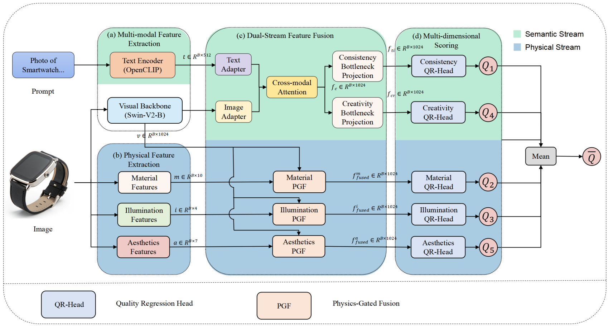
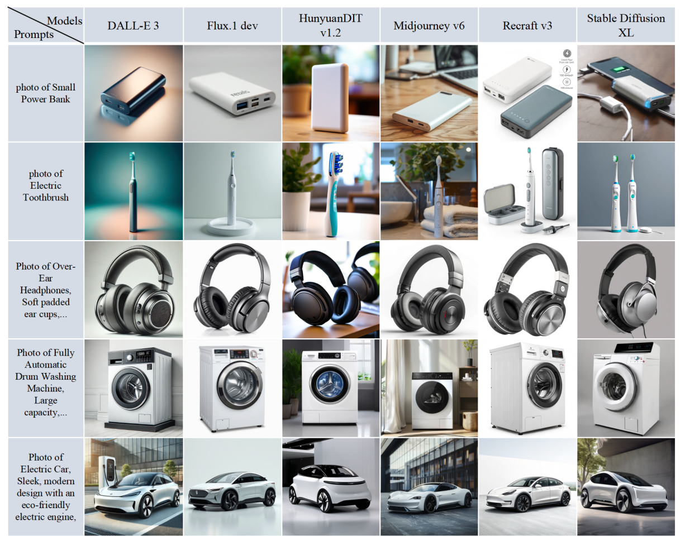

# SDIQA: Subjective and Objective Quality Assessment of AI-Generated Images in Industrial Design

Official PyTorch implementation of **SDIQA** (**S**emantic-physical **D**ual-stream **IQA**) and the **ID-AIGC-6K** database, from the paper:

> **Subjective and Objective Quality Assessment of AI-Generated Images in Industrial Design**
> Maosen Huang, Yu Luo, Guanghui Yue, Cheng Zhao, Jingao Gao, Yang Liu, Wei Zhou
> *IEEE Transactions on Emerging Topics in Computational Intelligence (TETCI)*

<p align="center">
  
</p>

## Highlights

- **ID-AIGC-6K database**: 6,000 AI-generated industrial-design images produced by six text-to-image models (Midjourney v6, Stable Diffusion XL, DALL·E 3, FLUX.1 dev, HunyuanDiT v1.2, Recraft v3) from 500 prompts that cover 11 product categories. Senior industrial designers rated every image on five dimensions.
- **Five quality dimensions**: image-text consistency, material and texture realism, illumination authenticity, creativity, and aesthetic appeal. The overall quality is the arithmetic mean of the five dimension scores.
- **Dual-stream architecture**:
  - *Semantic stream*: Swin-V2-B visual features and OpenCLIP text features are fused by cross-modal attention. Two residual bottleneck projections then produce dimension-specific features for consistency and creativity.
  - *Physical stream*: handcrafted illumination (4-D), material (LBP, 10-D) and aesthetic (7-D) descriptors are computed on the GPU. The **Physics-Gated Fusion (PGF)** module, consisting of PV-OPF, Visual Projection and Gated Residual Blending, injects them into the deep visual features.
  - Five parallel quality regression (QR) heads predict the five dimension scores.

## Repository Structure

```
sdiqa_git/
├── model.py          # SDIQA model (feature extractors, PGF, cross-modal attention, QR heads)
├── dataset.py        # ID-AIGC-6K dataset loader and transforms
├── metrics.py        # PLCC / SRCC
├── train.py          # Training (default hyper-parameters follow the paper)
├── evaluate.py       # Evaluation on the test split
├── infer.py          # Inference on custom images
├── requirements.txt
├── assets/           # Figures used in this README
└── LICENSE
```

## Installation

```bash
git clone https://github.com/hansonhuang077/SDIQA.git
cd SDIQA
conda create -n sdiqa python=3.10 -y
conda activate sdiqa
pip install -r requirements.txt
```

We tested the code with Python 3.10, PyTorch 2.6 and CUDA 12.x. The first run automatically downloads the Swin-V2-B weights (ImageNet-1K, via torchvision) and the OpenCLIP `ViT-B-32-quickgelu` weights (`laion400m_e32`).

## ID-AIGC-6K Database

<p align="center">
  
</p>

Download the database from Baidu Netdisk:

- **Link**: <https://pan.baidu.com/s/17aSAXsRQkCKpOfYo4E8vow?pwd=fkae>
- **Extraction code**: `fkae`

Unzip it into `ID-AIGC-6K/` so that the directory looks like:

```
ID-AIGC-6K/
├── image/            # 6,000 images, named <filename>.png
├── data.xlsx         # Annotations of all 6,000 images
├── train.xlsx        # 4,800 images
├── val.xlsx          #   600 images
└── test.xlsx         #   600 images
```

`data.xlsx` contains the annotations of the whole database, and `train.xlsx`, `val.xlsx` and `test.xlsx` are its official splits. The splits follow an 8:1:1 ratio and are stratified over the six generators and the two prompt complexity levels. Every annotation file contains the following columns:

| Column         | Description                                         |
| -------------- | --------------------------------------------------- |
| `filename`     | Image ID (the image file is `<filename>.png`)       |
| `prompt`       | Text prompt used to generate the image              |
| `consistency`  | Image-text consistency MOS, 1-5                     |
| `material`     | Material and texture realism MOS, 1-5               |
| `illumination` | Illumination authenticity MOS, 1-5                  |
| `creativity`   | Creativity MOS, 1-5                                 |
| `aesthetics`   | Aesthetic appeal MOS, 1-5                           |
| `overall`      | Overall quality, mean of the five dimensions        |
| `model`        | Text-to-image model that generated the image        |

The loader divides all scores by 5 during training. Predictions are mapped back to the 1-5 scale and clipped to [1, 5] when they are exported; PLCC / SRCC are computed on the unclipped outputs.

## Training

With the data placed under `ID-AIGC-6K/`, run:

```bash
python train.py
```

The default settings follow the paper: AdamW (learning rate 2e-5, weight decay 0.01), cosine annealing, batch size 16, at most 50 epochs with early stopping (patience 10), Smooth L1 loss (β = 1.0) summed over the five dimensions, and 448×448 input. The OpenCLIP text encoder stays frozen and Swin-V2-B is fine-tuned end to end. Run `python train.py -h` to list all options. For example, on a GPU with less memory:

```bash
python train.py --batch_size 8 --num_workers 2
```

By default, early stopping monitors the validation loss. Use `--early_stop_metric plcc` to monitor the average validation PLCC instead.

Outputs:

| File                          | Description                         |
| ----------------------------- | ----------------------------------- |
| `checkpoints/best_plcc.pth`   | Best average validation PLCC        |
| `checkpoints/best_loss.pth`   | Lowest validation loss              |
| `checkpoints/final.pth`       | Last epoch                          |
| `results/training_log.csv`    | Per-epoch losses and PLCC / SRCC    |

When training finishes, all three checkpoints are evaluated on `ID-AIGC-6K/test.xlsx`.

## Evaluation

```bash
python evaluate.py --checkpoint checkpoints/final.pth
# Optionally export per-image predictions
python evaluate.py --checkpoint checkpoints/final.pth --save_csv results/test_pred.csv
```

The script reports PLCC / SRCC on the overall quality, which is the mean of the five predicted dimension scores, and on each individual dimension.

## Inference

```bash
# Single image
python infer.py --image path/to/image.png \
    --prompt "Photo of Wireless Bluetooth Earphones, compact, ergonomic design, brushed metallic finish"

# All images in a folder that share one prompt
python infer.py --image_dir path/to/folder --prompt "..." --save_csv results/pred.csv
```

Python API:

```python
import torch
from PIL import Image
from model import SDIQAModel, load_checkpoint
from dataset import build_transforms

model = SDIQAModel(visual_pretrained=False).eval()
load_checkpoint(model, "checkpoints/final.pth")

image = build_transforms((448, 448))(Image.open("image.png").convert("RGB")).unsqueeze(0)
with torch.no_grad():
    scores = (model(image, ["Photo of a minimalist ceramic teapot"]) * 5.0).clamp(1.0, 5.0)  # (1, 5), 1-5 scale
print(scores.squeeze().tolist())  # [consistency, material, illumination, creativity, aesthetics]
print(scores.mean().item())       # overall quality
```

## Results on ID-AIGC-6K

| Method | Overall PLCC | Overall SRCC | Consistency | Material | Illumination | Creativity | Aesthetics |
| ------ | :----------: | :----------: | :---------: | :------: | :----------: | :--------: | :--------: |
| SDIQA  | 0.8164 | 0.8258 | 0.6819 / 0.6812 | 0.8294 / 0.8285 | 0.8142 / 0.8105 | 0.7178 / 0.7193 | 0.7579 / 0.7647 |

Dimension columns give PLCC / SRCC. The paper compares SDIQA with fourteen IQA methods.

## Citation

If you find this work useful, please cite:

```bibtex
@article{huang2026sdiqa,
  title   = {Subjective and Objective Quality Assessment of AI-Generated Images in Industrial Design},
  author  = {Huang, Maosen and Luo, Yu and Yue, Guanghui and Zhao, Cheng and Gao, Jingao and Liu, Yang and Zhou, Wei},
  journal = {IEEE Transactions on Emerging Topics in Computational Intelligence},
  year    = {2026},
  note    = {to appear}
}
```

## Acknowledgements

This code builds on [OpenCLIP](https://github.com/mlfoundations/open_clip) and [torchvision](https://github.com/pytorch/vision). We thank the industrial designers who took part in the subjective experiments.

## License

The code is released under the [MIT License](LICENSE). The ID-AIGC-6K database is for non-commercial academic research only.
